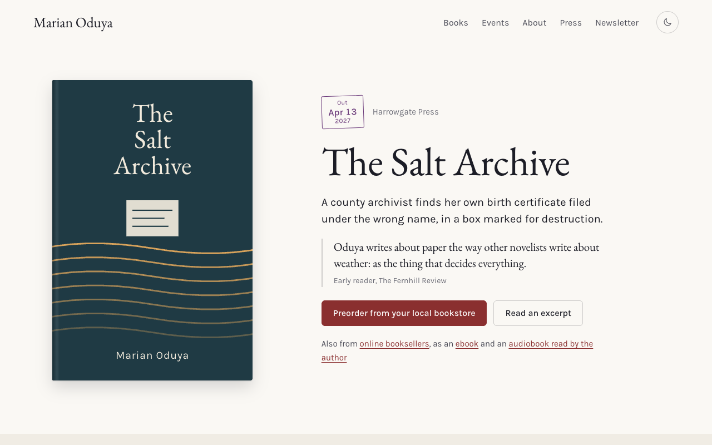

# Marian Oduya: Astro author website template

A novelist's website with an upcoming release and preorder links, a page per book with buy links, praise and an excerpt, events, a press kit, an about page and a newsletter sign-up. Light by default with a dark mode. Static, fast, and no server needed.



[](https://console.cloudzyro.com/new?repo=https://github.com/Cloudzyro/template-author)

## What's included

- Home page with the upcoming book large, its release date, a line of praise and preorder links, the backlist, the next events, a short bio and the newsletter
- Books page and a page per book: cover, release date, publisher and pages, buy links (bookstore, online, ebook, audiobook), the synopsis, an excerpt, praise and formats with ISBNs
- Book covers designed in code, each a distinct jacket with its own color and printed motif, so there are no images to license
- Events page with upcoming and past events and RSVP links, split by date at build time
- Press kit with publicist and agent contacts, short and long bios, assets and interviews; an about page with a portrait placeholder
- Newsletter sign-up on the home page and its own page
- A dark mode toggle that remembers the reader's choice (light unless they choose dark)
- Person, Book and Event structured data (schema.org), Open Graph tags, sitemap, robots.txt, favicon and a 404 page
- Responsive down to 360px, keyboard friendly, reduced motion respected

## Run it locally

```bash
pnpm install
pnpm dev        # http://localhost:4321
pnpm build      # static site in dist/
pnpm preview
```

## Make it yours

- **Content:** everything is in `src/data/site.ts`: the author, bios, agent and publicist, books, events, press and the newsletter's wording. Reviews, publications and ISBNs are samples; replace them with your own.
- **Books:** add a book to `books` and its page appears. Set `upcoming: true` on the next release to feature it on the home page. `buy` holds the links (they point to example.com until you change them). `cover` sets the jacket's colors and motif (`tide`, `window`, `rings` or `stems`), drawn by `src/components/BookCover.astro`; to use real covers, replace that component with an ``.
- **Events:** add events with dates as `YYYY-MM-DD`. Upcoming and past are worked out when the site builds, so redeploy after an event to move it to the past list.
- **Newsletter:** set `PUBLIC_NEWSLETTER_ENDPOINT` to your newsletter service's form address (Buttondown, ConvertKit, Formspree, a Supabase function or similar). The form sends `email` as form data. Without it the form uses `PUBLIC_FORM_ENDPOINT`, and with neither it shows a note and opens the visitor's email app addressed to the author's email.
- **Site address:** set `SITE_URL` (for example `https://www.marianoduya.com`) so the sitemap, canonical links and social previews use your domain.
- **Colors and fonts:** colors are CSS variables at the top of `src/styles/global.css`, with the dark mode values below them. Fonts are EB Garamond for headlines and quotes and Karla for everything else, self-hosted with Fontsource and imported in `src/layouts/Base.astro`.
- **Social preview image:** replace `public/og.png` (1200 x 630).

Environment variables are read at build time. Locally, put them in `.env` (see `.env.example`):

```bash
PUBLIC_NEWSLETTER_ENDPOINT=https://buttondown.example/your-list
PUBLIC_FORM_ENDPOINT=https://formspree.io/f/your-id
SITE_URL=https://www.marianoduya.com
```

## Deploy

Click the Deploy button above, or push your own copy to GitHub and connect it in the Cloudzyro console. Add the environment variables in your site's settings. The build command is `pnpm build` and the output folder is `dist/`, a plain static site.

## Stack

- Astro 7 (static output)
- @astrojs/sitemap
- Fontsource (EB Garamond, Karla)
- TypeScript, plain CSS

MIT licensed. See [LICENSE](./LICENSE).
